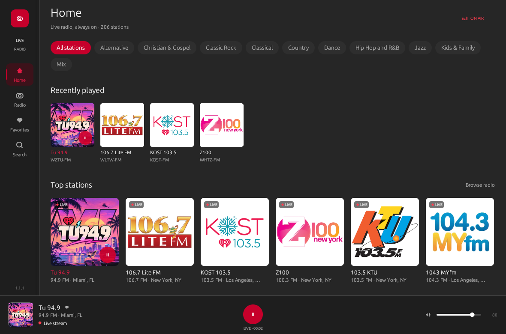
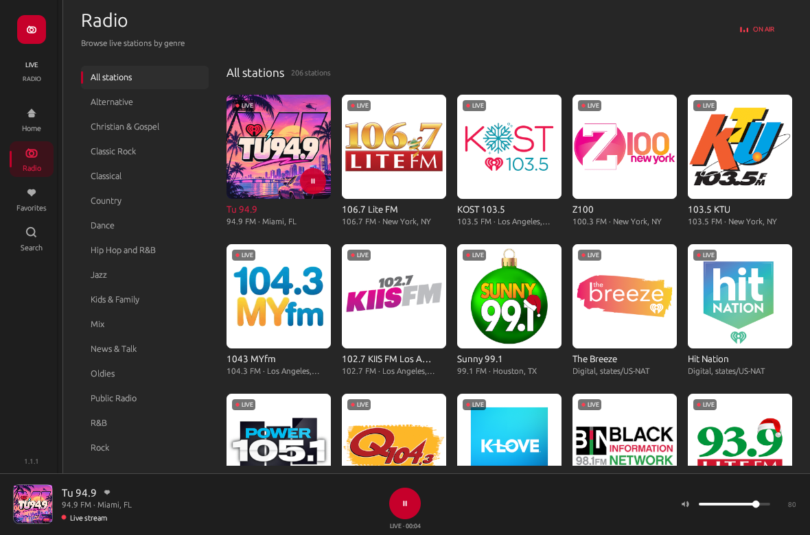
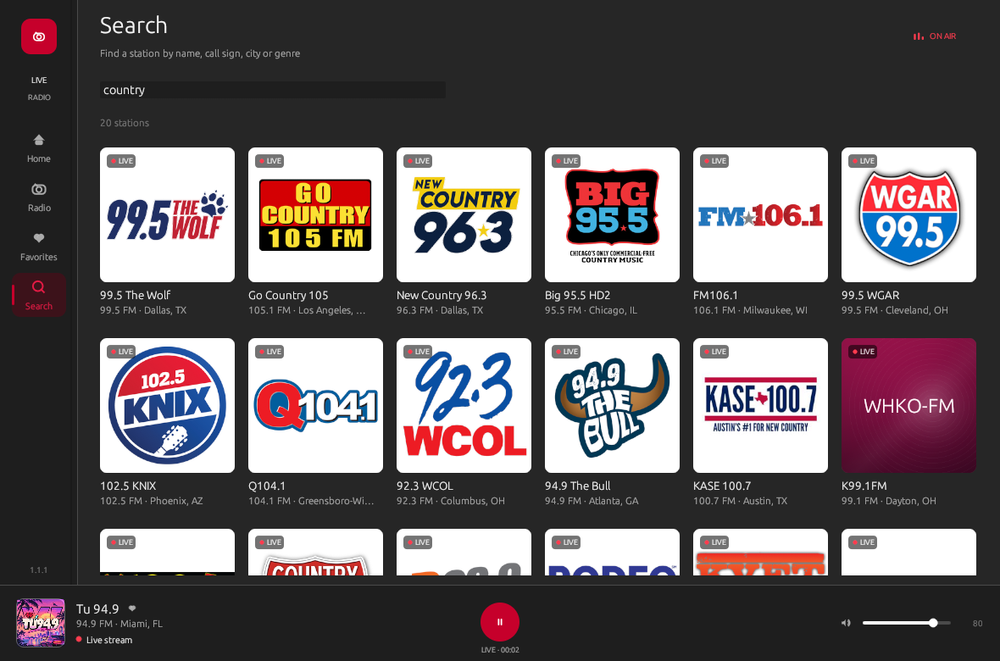
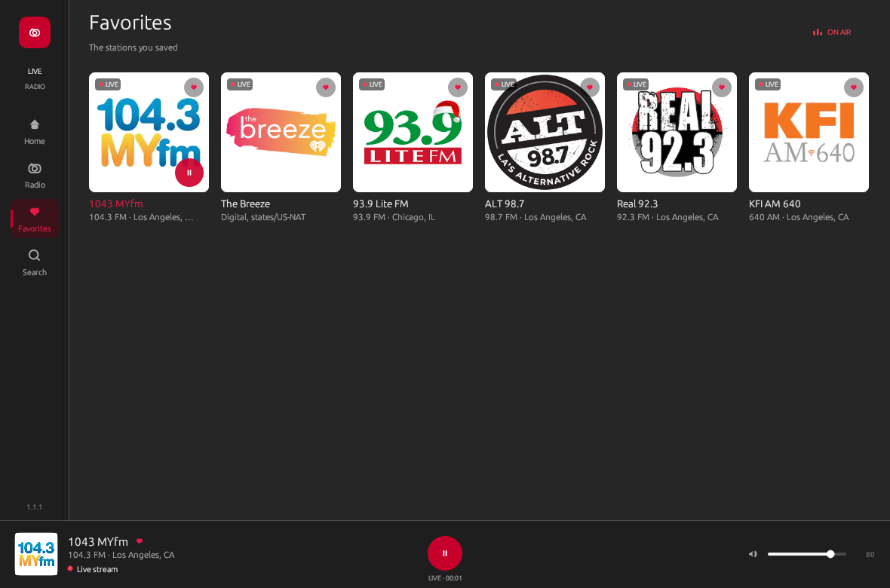
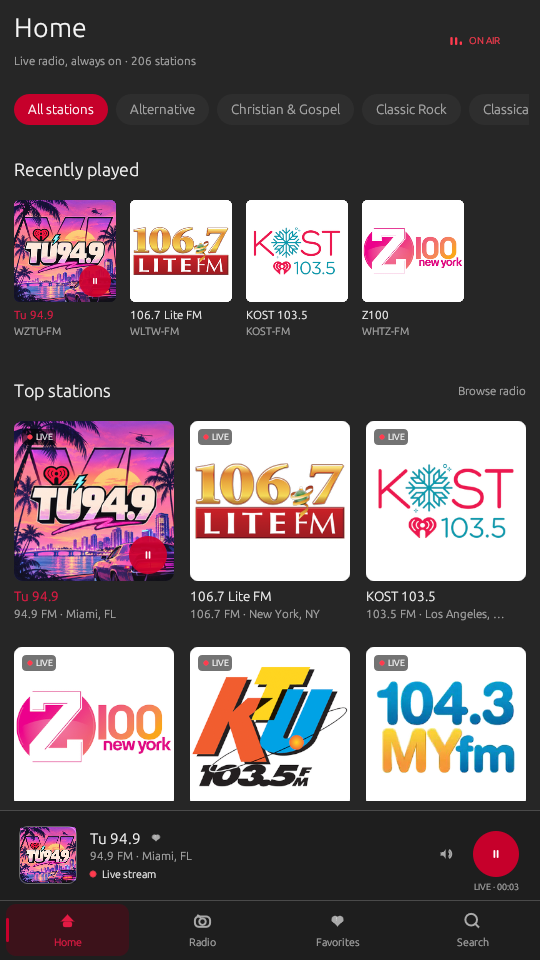
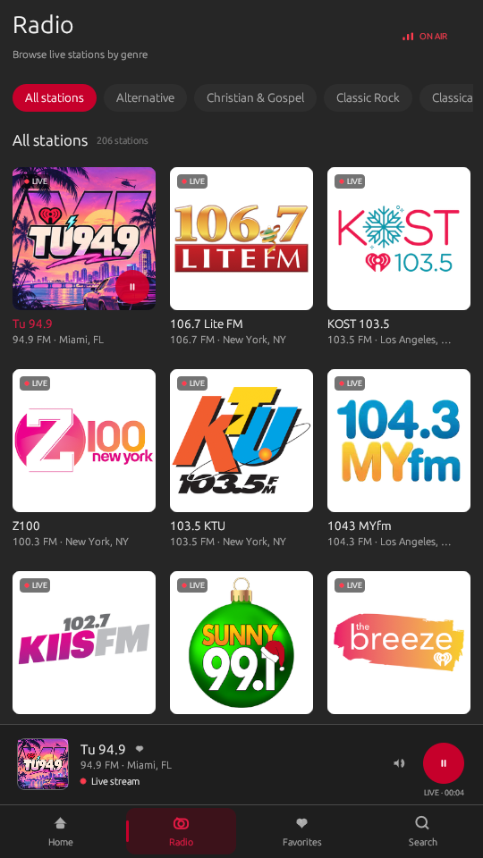

# Live Radio for Raspberry Pi

**Live radio for your Raspberry Pi: hundreds of stations, no account, one tap to play.**



## Description

Live Radio is a lightweight desktop radio player for Raspberry Pi OS. It brings
hundreds of live AM and FM stations from across the US to your Pi, across more
than 40 genres: Top 40, country, rock, hip-hop, news, sports, Spanish-language
and more. You don't need an account or a sign-in.

Browse by genre, search by name, call sign, city or frequency, and start a
station with one tap. Each station shows its own logo, and the player shows the
song or show that's on air now. Save your favourites with a heart, and your
recently played stations stay on the Home screen.

The app is built for small screens. On a normal monitor you get a sidebar
layout. Rotate the screen or use a tall touchscreen, and it switches by itself
to a phone-style layout with tabs along the bottom. It installs with
Raspberry Pi OS's own Package Installer, adds itself to the Sound & Video menu,
and uses little memory.

> Live Radio is an independent player. It is not affiliated with or endorsed by
> iHeartMedia. It plays the public live streams that stations publish online.

## Screenshots

| Browse by genre | Search |
|---|---|
|  |  |

| Favourites |
|---|
|  |

**Portrait mode:** the layout switches by itself on a rotated screen or touchscreen.

| Home (portrait) | Radio (portrait) |
|---|---|
|  |  |

## Features

### Listening
- **Hundreds of live stations** from across the US: about 240 of the most popular load at start-up, and each genre you open adds up to 60 more
- **One-tap play** from any station tile, with a large play/pause button in the player bar
- **Now playing:** the current song or show title, updated every 30 seconds
- **Live timer** showing how long you've been listening
- **Volume slider and mute**, remembered between sessions
- **Reliable streaming:** uses the HLS stream first, falls back to the direct stream, and buffers to ride out network hiccups
- **No account and no sign-in.** The app adds no ads of its own (stations still play their usual on-air ads).

### Finding stations
- **Home:** genre shortcuts, Recently Played and Top Stations at a glance
- **Radio:** browse all 40+ genres, with up to 60 stations per genre
- **Search:** instant results by station name, call sign, city, genre, description or frequency, across every station loaded so far
- **Station cards** show the logo, frequency and band (e.g. "100.3 FM") and the city

### Your stations
- **Favourites:** tap the heart on a station or in the player to save it
- **Recently Played:** your last 12 stations, kept on the Home screen
- Saved stations update their stream links and logos by themselves, so they keep working

### Looks and layout
- **Real station logos**, downloaded in the background and kept on disk so they appear straight away next time
- **Dark theme** that's easy on the eyes on a TV or a small display
- **Automatic portrait mode** when the window is taller than it is wide or narrower than 760 px:
  - tabs move to a bar along the bottom
  - a compact player bar
  - genre chips and Recently Played you can swipe sideways
  - station grid reflows to fit
- **Opens maximised** on a portrait monitor
- **Full-screen mode** (`live-radio --fullscreen`) with a large **Return to Player** button, for kiosk setups or launching from another app
- **Works with touch:** drag to scroll, large tap targets
- Window can be as small as 360×480

### Keyboard
- **Space:** play / pause (while no text field has focus)
- **Ctrl+F:** jump to Search

### On the Pi
- **Installs with the built-in Package Installer**
- Dependencies (mpv, curl) are pulled in automatically
- **Runs on Raspberry Pi OS Bookworm and Bullseye** (64-bit, arm64), on X11 or Wayland
- Adds a **menu entry and icon** under Sound & Video
- Small and fast: a native app (about 8 MB), with no browser or Electron underneath

## Requirements
- Raspberry Pi 3, 4, 5 or 400 running **64-bit** Raspberry Pi OS (Bullseye or newer). A 32-bit OS can't run the arm64 package.
- An internet connection
- Speakers, headphones or HDMI audio

## Install

1. Download `live-radio_1.1.2_arm64.deb` from the
   [latest release](https://github.com/chrisdamonpoe-byte/Live-Radio-for-RPI/releases/latest).
2. Double-click it in the Pi's file manager and choose **Install**, or run:

   ```sh
   sudo apt install ./live-radio_1.1.2_arm64.deb
   ```

3. Start it from **Menu → Sound & Video → Live Radio**, or run `live-radio`.

To remove it:

```sh
sudo apt remove live-radio
```

Favourites and settings are kept in `~/.config/live-radio/state.json`, and
logos in `~/.cache/live-radio/logos`. Removing the package leaves both in place.

To use portrait mode on a rotated screen, go to **Preferences → Screen
Configuration**, right-click the display and choose **Orientation**.

## Build from source

The app is written in Rust with [egui](https://github.com/emilk/egui). Audio
playback uses `mpv`, and web requests go through `curl`.

On the Pi itself:

```sh
cargo build --release
# binary: target/release/live-radio
```

Cross-compiling from Windows uses [cargo-zigbuild](https://github.com/rust-cross/cargo-zigbuild)
against glibc 2.28, so the binary runs on both Bullseye and Bookworm. The
packaging script needs GNU `ar`, `tar` and `xz` (MSYS2 provides them):

```sh
cargo zigbuild --release --target aarch64-unknown-linux-gnu.2.28
powershell -ExecutionPolicy Bypass -File packaging/build-deb.ps1
# package: dist/live-radio_1.1.2_arm64.deb
```

### Screenshot mode

For visual checks without clicking through the app:

```sh
live-radio [--size 540x960] [--tab home|radio|favorites|search] [--search text] --screenshot out.png
```

The app renders about 120 frames, saves a PNG and exits.

## Notes and limits

- Only live stations are included: no podcasts, playlists or account features.
- Station availability can vary by region.
- The app uses public, undocumented endpoints, which could change without notice.
- `MECHANICS.md` and `mechanics.json` describe what was learned from studying the original Android app.

## License

MIT (see `packaging/copyright`). Station names, logos and streams belong to
their owners and are loaded from their public sources at run time; none are
included in this repository or the package.
